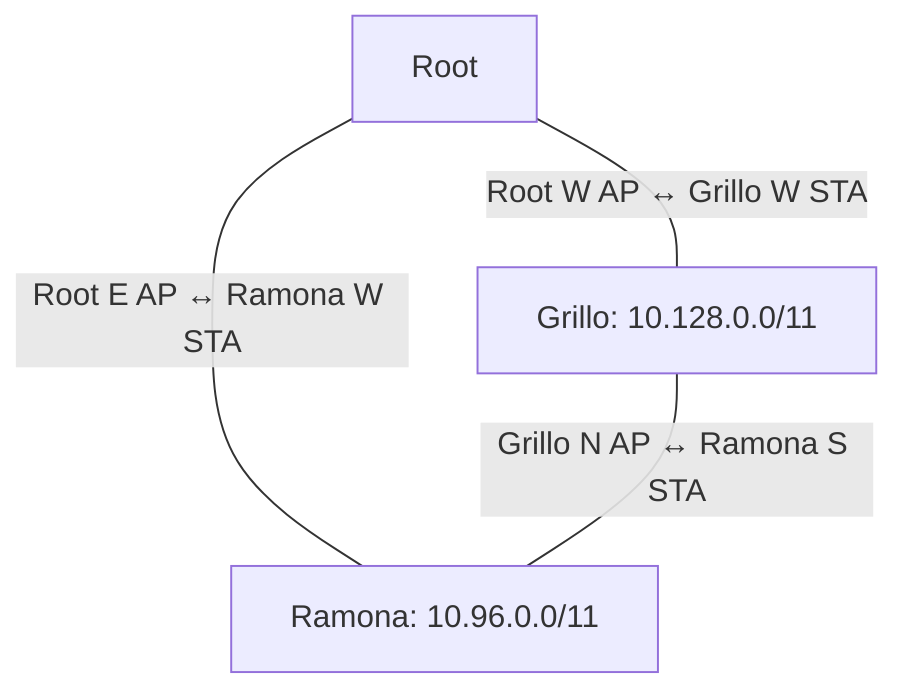

# Topología observada en la telemetría

Captura aportada por el usuario el 8 de octubre de 2026, entre 19:45:03 y
19:45:38. Las horas son las que imprime la RPi; no se usaron para calcular
latencias entre nodos. Root reporta uptime 107 min; Grillo 18 min; Ramona 19 min.

| Enlace | Extremo AP | Extremo Station | RSSI AP / Station |
| --- | --- | --- | --- |
| Root–Grillo | Root W, `I4A_W_000000000000` | Grillo W | -77 / -76 dBm |
| Root–Ramona | Root E, `I4A_E_000000000000` | Ramona W | -86 / -83 dBm |
| Grillo–Ramona | Grillo N, `I4A_N_142B2FC05E7D` | Ramona S | -38 / -22 dBm |

El campo `uuid` de cada fila es la MAC/identidad de la placa individual.
El UUID del nodo utilizado por los SSID se identifica en la fila central:
Grillo `142B2FC05E7D`, Ramona `20E7C85AA245`. En un AP, `link` indica su propio
SSID; la evidencia del vecino se obtiene del extremo Station. RSSI y contadores
de ambos extremos son coherentes con el enlace. Las filas pueden tener cierta
antigüedad por el reparto periódico de información dentro del anillo.

Grillo conserva N=10.132.0.0/14, S=10.136.0.0/14, E=10.140.0.0/14,
W=10.144.0.0/14 y C=10.148.0.0/14. Ramona conserva N=10.100.0.0/14,
S=10.104.0.0/14, E=10.108.0.0/14, W=10.112.0.0/14 y C=10.116.0.0/14.
Ramona S acepta la subred ofrecida por Grillo N, 10.132.0.0/14, que es mayor
y más específica que el bloque de Ramona 10.96.0.0/11; no adopta esa oferta
como nueva asignación del nodo.

## Ensayo siguiente

Conectar el cliente a Ramona y registrar su IP, máscara y gateway. Primero
comprobar ping a su gateway, RPi e internet. Mantener los pings sin reconectar
el cliente. Interrumpir solo Root E–Ramona W; conservar Root W–Grillo W y
Grillo N–Ramona S. El recorrido alternativo esperado es Ramona–Grillo–Root–RPi.

El corte debe afectar únicamente a esa radio/enlace, no a la alimentación de
una placa del anillo ni a todo Root. Cambiar valores desde el portal reinicia
el nodo y no valida este caso de failover sin reinicio. Con antenas de mesa,
se necesita atenuación selectiva de la antena de Ramona W o de Root E, o un
control de deshabilitación de radio en tiempo de ejecución. La versión actual
no tiene ese botón en el portal. No se ha ejecutado el corte ni comprobado la
recuperación: esta captura confirma topología, no failover ni estabilidad prolongada.
